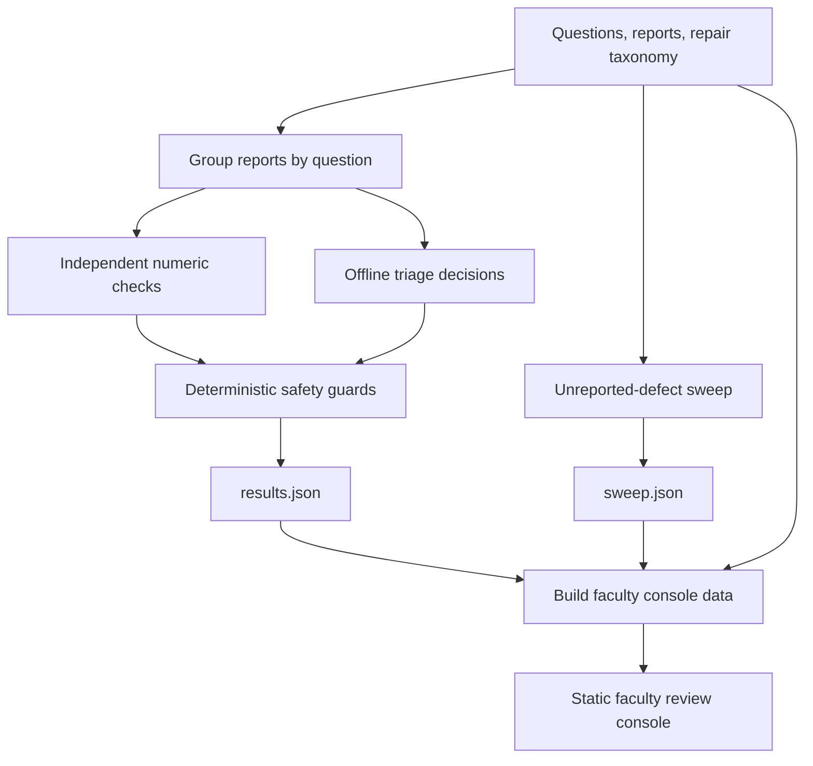

# Acadza Report → Fix

**A safety-first workflow for turning JEE/NEET student error reports into reviewable question-bank corrections.**

The prototype groups reports by question, checks the question independently where numeric verification is available, proposes a narrowly scoped correction, and applies deterministic safety checks before assigning a review route. A static faculty console makes the resulting queue, evidence, edits, and guard decisions inspectable.

> **Scope note:** This repository is a working prototype evaluated on the supplied sample (43 questions and 44 student reports). It is not connected to Acadza's production question bank or student reporting system. The offline decisions included here are reproducible from the committed decision file. The optional Anthropic-powered triage pipeline is implemented but was not run to generate this submission's committed results.

## What it does

- **Groups related reports:** Multiple reports about the same question are considered together, reducing duplicate investigation.
- **Independent numeric checks:** A small set of numeric questions has independent Python/SymPy checks. These checks do not read the student's comment or the stored answer key while deriving the computed value.
- **Structured triage:** Each report has a verdict, repair category, confidence, evidence, and a student-facing reply. Repair types and editable fields are constrained by `data/taxonomy.json`.
- **Deterministic safety gates:** The model-stage decision does not choose its own route. `engine/guards.py` validates edit scope, exact-match uniqueness, repair-specific constraints, confidence, taxonomy policy, prompt-injection flags, and answer-key checks where applicable.
- **Faculty review console:** A static console groups work by question, prioritizes higher-impact issues, displays proposed changes and guard outcomes, and supports approve, edit, reject, undo, and local audit history.
- **Proactive defect sweep:** `engine/sweep.py` records 11 additional defects found in the sample without a corresponding student report.

## Architecture



### Safety principle

**The AI proposes; deterministic code assigns the route.** The guard layer returns one of:

| Route | Meaning |
|---|---|
| `auto_apply` | The proposed edit passed every applicable guard and the repair type permits automation. It remains visible in the console's verification lane and can be undone. |
| `faculty_review` | The proposal needs a human decision or failed at least one guard. |
| `no_change` | The report does not justify changing the question record. |

Answer-key changes are gated by independent numeric checks where available. Authored content, uncertain interpretation, and repair types marked human-only are not automatically applied. Student comments are treated as untrusted input; an instruction embedded in a report is not treated as an instruction to the system.

## Results on the supplied sample

The committed offline pipeline processes **44 reports across 43 question records**. The route counts below are generated from `results.json` by `python -m engine.run`.

| Report route | Count |
|---|---:|
| Auto-apply (guard-approved) | 19 |
| Faculty review | 8 |
| No change | 17 |
| **Total** | **44** |

The report verdict distribution is: 27 `defect`, 10 `no_error`, 2 `display_issue`, 2 `not_actionable`, 1 `already_fixed`, 1 `app_issue`, and 1 `language_mode`.

The separate sweep identifies **11 unreported defects**: 7 pass the current auto-apply guards and 4 are routed to faculty review. The generated console contains **50 review items across 40 question records** (reported items can be grouped, and sweep findings are added separately).

These figures describe this supplied sample and this committed offline run; they should not be interpreted as production accuracy, coverage, or performance metrics.

## Repository layout

```text
.
├── data/
│   ├── questions.json       # Supplied question records
│   ├── reports.json        # Supplied student error reports
│   └── taxonomy.json       # Allowed verdicts, repairs, field scopes and auto policy
├── engine/
│   ├── mathtext.py         # HTML/MathML helpers
│   ├── checks.py           # Independent numeric checks (Python/SymPy)
│   ├── decisions.json      # Committed offline triage decisions
│   ├── make_decisions.py   # Offline decision-generation source
│   ├── guards.py           # Deterministic edit validation and route assignment
│   ├── run.py              # Decisions → results.json
│   ├── sweep.py            # Additional unreported-defect sweep
│   ├── build_console.py    # Results + sweep → console/data.js
│   ├── prompts.py          # Prompts for the optional live LLM pipeline
│   └── triage.py           # Optional Anthropic-powered triage pipeline
├── console/
│   ├── index.html          # Static faculty console
│   └── data.js             # Generated console data
├── results.json            # Per-report decisions and guard logs
├── sweep.json              # Unreported-defect findings and guard logs
├── PROMPTS.md              # Prompt documentation and development notes
└── PRODUCT.md              # Product reasoning and safety principles
```

## Run locally

### Requirements

- Python 3.10 or newer
- `pip`
- Internet access is not required for the committed offline pipeline after dependencies are installed

### 1. Get the project and install dependencies

```bash
git clone <your-repository-url>
cd <repository-folder>
python -m venv .venv
```

Activate the environment:

**Windows PowerShell**

```powershell
.\.venv\Scripts\Activate.ps1
```

**macOS / Linux**

```bash
source .venv/bin/activate
```

Install the packages:

```bash
python -m pip install beautifulsoup4 lxml sympy
```

### 2. Regenerate the offline results

Run these commands from the repository root, in this order:

```bash
python -m engine.run
python -m engine.sweep
python -m engine.build_console
```

This regenerates `results.json`, `sweep.json`, and `console/data.js` from the committed input data and decisions.

### 3. Open the faculty console

You can open `console/index.html` directly in a browser. Alternatively, serve the static folder locally:

```bash
python -m http.server 8000 --directory console
```

Then visit <http://localhost:8000>.

The console reads precomputed data from `console/data.js`; it does not call an LLM when the page loads. Console actions and audit history are stored in the browser's `localStorage`, so they are local to that browser and are not a shared, server-side audit record.

## Optional: run the live LLM triage pipeline

`engine/triage.py` contains an optional Anthropic integration. It performs a blind-solver call on the question stem and a grouped triage call for the reports associated with that question. The resulting decisions are then passed through the same deterministic offline guard pipeline.

This optional path was **not executed to produce the committed submission results**. Running it requires an Anthropic API key and may incur API charges. It will overwrite `engine/decisions.json`, so keep a copy of the committed file if you want to preserve the offline baseline.

Install the optional SDK:

```bash
python -m pip install anthropic
```

Set your key and run:

**Windows PowerShell**

```powershell
$env:ANTHROPIC_API_KEY = "your-api-key"
python -m engine.triage
python -m engine.run
python -m engine.build_console
```

**macOS / Linux**

```bash
export ANTHROPIC_API_KEY="your-api-key"
python -m engine.triage
python -m engine.run
python -m engine.build_console
```

The model can be selected with the `MODEL` environment variable. Review the generated decisions and guard logs before using any result beyond this sample. Do not put API keys in source control.

## Deploy the console

The console is a static site. Deploy the contents of `console/` using any static hosting provider (for example, Netlify, Vercel, or GitHub Pages). No backend server is required for the included precomputed demo. User actions remain browser-local because the prototype has no authentication or shared persistence layer.

## Known limitations

- The evaluation data is a small sample (43 questions, 44 reports), not the full question bank.
- The committed decisions were prepared offline; the optional live LLM path has not been validated end-to-end for this submission.
- Independent numeric checks cover only selected numeric questions; they are not a general-purpose JEE/NEET solver.
- The console is static. It has no user authentication, role-based access control, database persistence, or shared audit service.
- Human review is still required for authored content, ambiguous defects, and repairs that cannot be safely grounded in the stored record.
- The prototype does not write approved changes back to a production question bank.

## Further documentation

- [`PROMPTS.md`](PROMPTS.md) — prompts, what was actually run, and development/failure notes.
- [`PRODUCT.md`](PRODUCT.md) — product rationale, safety boundaries, and the proposed week-one trust metric.

## License

No license is specified in this submission. Contact the repository owner before reusing the code or data outside the assignment context.
